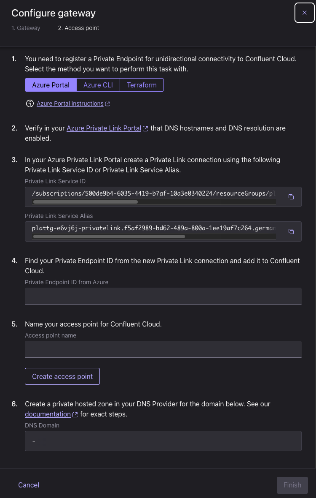
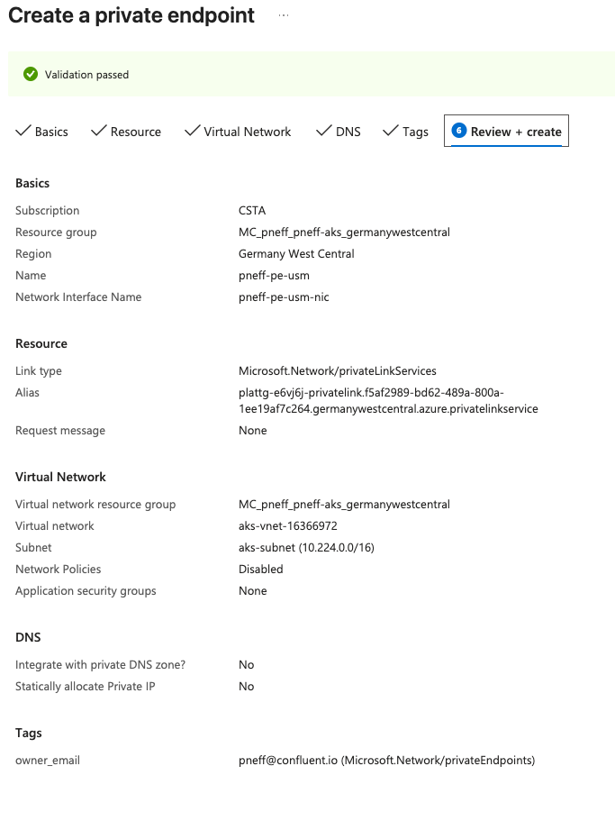
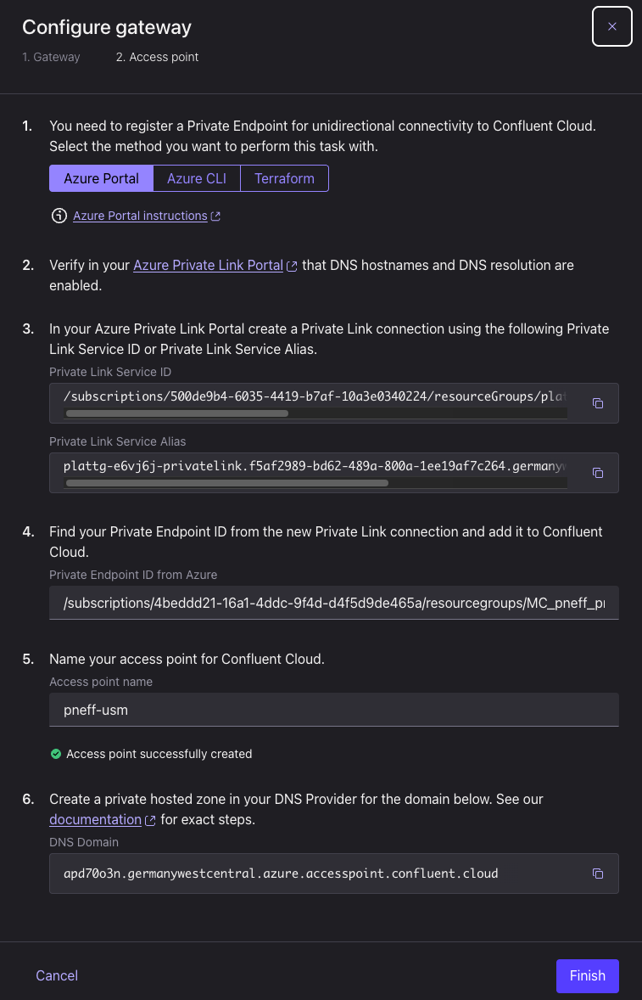
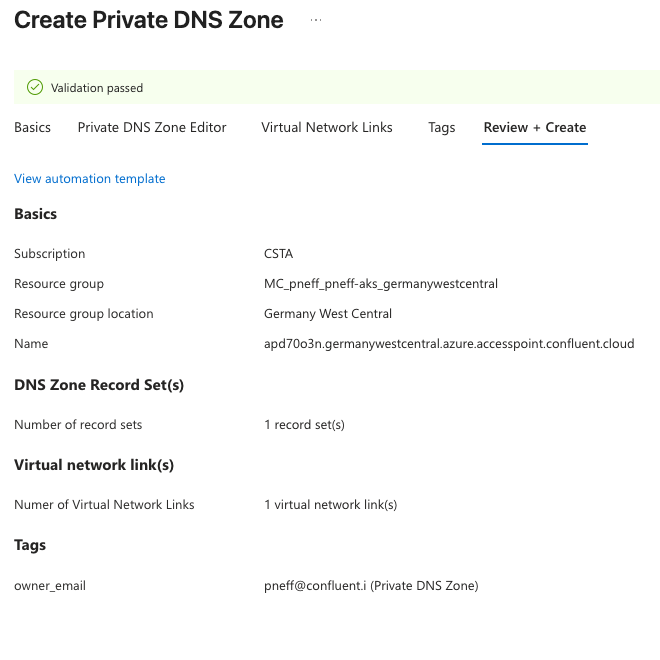

# Self-managed Connect on AKS → Confluent Cloud Kafka, monitored with Unified Stream Manager (USM)

A step-by-step demo for a **different scenario** than the `main` branch: there is **no Confluent Platform Kafka cluster**. Only a **self-managed Kafka Connect cluster** runs on Azure Kubernetes Service (AKS), using Confluent for Kubernetes (CFK). It bootstraps against a **Confluent Cloud Kafka cluster** and is monitored in Confluent Cloud with **Unified Stream Manager**.

- **Phase A:** AKS cluster and Confluent for Kubernetes.
- **Phase B:** Confluent Cloud: Kafka cluster, USM Private Link for the agent, topic, service accounts.
- **Phase C:** deploy the USM Agent, Connect and a Datagen connector on AKS.
- **Phase D:** register the Connect cluster with USM.

**How the steps work**
- Azure and Confluent Cloud steps use the **Portal / Cloud Console**. The CLI version is in a collapsed *CLI alternative* note.
- Kubernetes steps use `kubectl` and `helm`.

---

## Table of contents

- [References](#references)
- [Architecture](#architecture)
- [Prerequisites](#prerequisites)
- **Phase A: AKS and Confluent for Kubernetes**
  - [A1. Create the AKS cluster and namespace](#a1-create-the-aks-cluster-and-namespace)
  - [A2. Install Confluent for Kubernetes](#a2-install-confluent-for-kubernetes)
- **Phase B: Confluent Cloud**
  - [B0. Create the Kafka cluster](#b0-create-the-kafka-cluster)
  - [B1. USM setup wizard and Private Link](#b1-usm-setup-wizard-and-private-link)
  - [B2. Create the topic](#b2-create-the-topic)
  - [B3. Service account for Connect](#b3-service-account-for-connect)
- **Phase C: Deploy on AKS**
  - [C1. Kubernetes secrets](#c1-kubernetes-secrets)
  - [C2. Deploy the USM Agent](#c2-deploy-the-usm-agent)
  - [C3. Deploy Connect](#c3-deploy-connect)
  - [C4. Demo data with Datagen](#c4-demo-data-with-datagen)
- **Phase D: Register Connect with USM**
  - [D1. Register the Connect cluster](#d1-register-the-connect-cluster)
- [Cleanup](#cleanup)

---

## References

1. [USM in Confluent Cloud](https://docs.confluent.io/cloud/current/usm/overview.html): registration, Azure private networking, agent setup, monitoring, troubleshooting.
2. [Register a self-managed Connect cluster with Confluent Cloud Kafka as the metadata cluster](https://docs.confluent.io/cloud/current/usm/register-connect/cloud-kafka.html): the registration flow this scenario follows.
3. [USM in Confluent Platform](https://docs.confluent.io/usm/current/overview.html): supported versions, the metrics and metadata that are sent, agent sizing.
4. [Confluent for Kubernetes](https://docs.confluent.io/operator/current/overview.html): deploying CFK, configuring USM, the compatibility matrix.
5. [CFK hybrid examples](https://github.com/confluentinc/confluent-kubernetes-examples/tree/master/hybrid): self-managed Connect against Confluent Cloud, and the USM Agent manifests.
6. [Azure Kubernetes Service](https://learn.microsoft.com/azure/aks/): creating a cluster, networking, connecting with `kubectl`.

---

## Architecture


<!-- TODO screenshot: architecture for the Connect-only scenario -->

- **Two separate paths leave AKS:**
  - **Data path (public internet):** Connect produces to and consumes from the Confluent Cloud Kafka cluster (SASL_SSL, API key) and uses Confluent Cloud Schema Registry (HTTPS, API key). The Connect internal topics (configs, offsets, status) live in Confluent Cloud too.
  - **USM path (Azure Private Link):** Connect workers send connector metadata and metrics to the **USM Agent** in the same AKS cluster. The agent forwards them to Confluent Cloud over Private Link.
- **No Confluent Platform Kafka.** In USM terms, the Confluent Cloud cluster is the Connect cluster's **metadata cluster**. Only the Connect cluster is registered; the Cloud Kafka cluster needs no registration.
- **Private networking is mandatory for USM, even with a public Kafka cluster.** On Azure: an **Ingress PrivateLink Gateway** and an **Access Point** in Confluent Cloud, a **Private Endpoint** in the AKS VNet, and a **Private DNS zone**.

---

## Prerequisites

| Component | Version | Note |
|---|---|---|
| Confluent Platform (Connect) | **8.2.4** | Not affected by the "Connect metrics missing from USM" issue (7.9.6–7.9.8, 8.1.2–8.1.4, 8.2.0–8.2.2 and 8.3.0 are). |
| USM Agent | **1.2.1** | If it misbehaves under CFK, try `cp-usm-agent:1.1.1` in [`10-usmagent.yaml`](k8s/connect-cc/10-usmagent.yaml). |
| CFK | **3.3.1** (Helm chart `0.1718.99`) | |
| Datagen connector | 0.7.2 | |

**Confluent Cloud Kafka cluster**
- **Standard** cluster, public endpoint, **Azure germanywestcentral** (the same region as the USM Private Link).
- Any cluster type works for Connect itself. Enterprise has no public endpoint, so it doesn't fit this variant. The USM docs list no cluster-type requirement, only that the cluster runs on **Azure or AWS**.

**Accounts**
- **Confluent Cloud:** `OrgAdmin`, plus an environment with the **Advanced** Stream Governance package.
- **Azure:** a subscription where you can create AKS, private endpoints and private DNS zones (Contributor is enough).
- **Outbound internet** from the AKS nodes. Connect needs it for Confluent Hub (plugin download) and for the public Kafka and Schema Registry endpoints. AKS allows outbound traffic by default.

---

# Phase A: AKS and Confluent for Kubernetes

## A1. Create the AKS cluster and namespace

1. Azure Portal → **Kubernetes services** → **Create** → **Kubernetes cluster**.
2. **Basics:** resource group `rg-usm-lab`, cluster name `aks-usm-lab`, region **Germany West Central**. Keep the defaults for everything else.
3. **Review + create** → **Create**. This takes about 5–10 minutes.
4. Connect `kubectl`: on the cluster page, click **Connect** and run the `az aks get-credentials` command it shows.
5. Create the namespace `confluent`. All Connect and USM resources in this demo go there.
   ```bash
   kubectl create namespace confluent
   ```

✅ **Check:** `kubectl get nodes` shows all nodes `Ready`, and `kubectl get namespace confluent` shows `Active`.

<details><summary>CLI alternative</summary>

```bash
az group create --name rg-usm-lab --location germanywestcentral
az aks create -g rg-usm-lab -n aks-usm-lab --location germanywestcentral --generate-ssh-keys
az aks get-credentials -g rg-usm-lab -n aks-usm-lab
kubectl create namespace confluent
```
</details>

## A2. Install Confluent for Kubernetes

```bash
helm repo add confluentinc https://packages.confluent.io/helm
helm repo update
helm upgrade --install confluent-operator confluentinc/confluent-for-kubernetes \
  --version 0.1718.99 --namespace confluent
```

✅ **Check:** `kubectl -n confluent get pods` shows `confluent-operator-…` as `Running`.

> [!NOTE]
> ### Checkpoint A: AKS is ready
> - ✅ AKS cluster `aks-usm-lab` with namespace `confluent`
> - ✅ CFK operator is running
>
> **Next:** prepare Confluent Cloud.

---

# Phase B: Confluent Cloud

## B0. Create the Kafka cluster

1. CC UI → **Environments** → your environment (Advanced governance) → **Add cluster**.
2. Type **Standard**, provider **Microsoft Azure**, region **Germany West Central (germanywestcentral)**, single zone is fine for the lab.
3. Name it, e.g. `connect-lab`, and **Launch cluster**.
4. Note three values:

| Value | Where | Example |
|---|---|---|
| **Cluster ID** | Cluster → **Cluster settings** → **General** | `lkc-xxxxxx` |
| **Bootstrap server** | Cluster → **Cluster settings** → **Endpoints** | `pkc-xxxxx.germanywestcentral.azure.confluent.cloud:9092` |
| **Schema Registry endpoint** | Environment → **Schema Registry** (right side panel / *Stream Governance API*) | `https://psrc-xxxxx.germanywestcentral.azure.confluent.cloud` |

```bash
export CC_ENV_ID="env-xxxxxx"
export CC_KAFKA_ID="lkc-xxxxxx"
export CC_BOOTSTRAP="pkc-xxxxx.germanywestcentral.azure.confluent.cloud:9092"
export CC_SR_URL="https://psrc-xxxxx.germanywestcentral.azure.confluent.cloud"
```

> ⚠️ Use the **public** Schema Registry endpoint, not the private one. Connect talks to Schema Registry over the internet in this scenario.

<details><summary>CLI alternative</summary>

```bash
confluent kafka cluster create connect-lab \
  --cloud azure --region germanywestcentral --type standard --environment "$CC_ENV_ID"
confluent kafka cluster describe "$CC_KAFKA_ID" --environment "$CC_ENV_ID"     # Endpoint = SASL_SSL://<bootstrap>
confluent schema-registry cluster describe --environment "$CC_ENV_ID"           # Endpoint URL, Cluster ID (lsrc-…)
```
</details>

## B1. USM setup wizard and Private Link

The wizard sets up private networking, creates the agent's service account and API key, and generates the **agent configuration file**. You switch to the Azure Portal twice: once for the Private Endpoint, once for DNS. This Private Link is **only for the USM Agent**. Connect's Kafka traffic doesn't use it.

> [!NOTE]
> ### How the private connection works
> USM only works over a private connection, so the agent never reaches Confluent Cloud over the public internet. You build it from four pieces:
>
> | Piece | Where | What it does | Step |
> |---|---|---|---|
> | **Private Link** (gateway) | Confluent Cloud | Confluent's private entrance in Germany West Central | 2 |
> | **Private Endpoint** | Azure, in `aks-subnet` | A private IP in your VNet (e.g. `10.224.0.6`) that leads to that entrance | 3 |
> | **Access point** | Confluent Cloud | Confluent accepts your endpoint: "this one is allowed in" | 4 |
> | **Private DNS zone** | Azure, linked to the AKS VNet | Makes Confluent's hostname point to the private IP | 5 |
>
> **What happens when the agent connects:**
> 1. The agent looks up its Confluent address (`FRONTDOOR_URL`), e.g. `api-apd70o3n.germanywestcentral.azure.accesspoint.glb.confluent.cloud`.
> 2. Confluent's public DNS answers: "that's an alias for `api.apd70o3n.germanywestcentral.azure.accesspoint.confluent.cloud`".
> 3. That name ends with your Private DNS zone's name, so Azure answers from your zone: **`10.224.0.6`**.
> 4. The agent connects to `10.224.0.6`. The Private Endpoint carries the traffic over Azure Private Link to Confluent Cloud.
>
> If one piece is missing, point 3 returns a public address or none at all, and the agent fails with `503`.

**1. Start the wizard**
CC UI → **Environments** → your environment → **Clusters** → `connect-lab` → **Connectors** → **Self-managed** → **Register Connect cluster** → **New agent** → **Get started**.

<!-- TODO screenshot: wizard start from Connectors → Self-managed -->

> ℹ️ The wizard ends by asking for the Connect cluster ID. Connect doesn't exist yet. Finish networking, service account and config file here, deploy in Phase C, and come back in [D1](#d1-register-the-connect-cluster) with **Existing agent**.

**2. Network: create the gateway**
**Add network configuration** → **Microsoft Azure**, region **germanywestcentral** → submit. Copy the **Private Link Service alias/ID** it shows.

 

**3. Azure Portal: create the Private Endpoint**
**Private endpoints** → **Create**:
- **Basics:** resource group `rg-usm-lab`, name `pe-confluent-usm`, region **Germany West Central**.
- **Resource:** **Connect to an Azure resource by resource ID or alias** → paste the alias.
- **Virtual network:** the AKS-managed VNet `aks-vnet-…` (in resource group `MC_rg-usm-lab_aks-usm-lab_germanywestcentral`), subnet `aks-subnet`.
- **DNS:** skip; you create the zone in step 5.



After creation, open the endpoint → **Overview** → **JSON View** and copy the **Resource ID**. It looks like `/subscriptions/…/resourceGroups/rg-usm-lab/providers/Microsoft.Network/privateEndpoints/pe-confluent-usm`.

> ⚠️ Putting the endpoint in the AKS-managed VNet is a demo shortcut. In production, bring your own VNet.

**4. Wizard: let Confluent accept the endpoint (access point)**

The endpoint you just created is only a **connection request** to Confluent. Its status in Azure is **Pending**. Confluent accepts it once you tell it which endpoint is yours. That registration is called an **access point**.

1. Back in the wizard, paste the endpoint's **Resource ID** and create the access point.
2. Wait until the access point shows **Ready** (a few minutes).
3. Note the **access point ID**. It starts with `ap-` (e.g. `ap-d70o3n`), and you need it for the DNS zone name in step 5. Find it in the Cloud Console: your Private Link → **Access points** → **ID** column.
4. In Azure, the endpoint → **Overview** → connection status now shows **Approved**.

> ℹ️ **Two different IDs.** The **Resource ID** comes from Azure (`/subscriptions/…/privateEndpoints/<name>`). You paste it into the wizard. The **access point ID** comes from Confluent Cloud (`ap-…`). It goes into the DNS zone name in step 5, **without the hyphen**.

 

**5. Azure Portal: Private DNS zone**

This is point 3 in the box above: the zone tells AKS "Confluent's hostnames are at your endpoint's private IP". A DNS record needs an IP address, so first get the IP:

- The endpoint → **Settings** → **DNS configuration** → copy the **IP address** (e.g. `10.224.0.x`).

Then **Private DNS zones** → **Create** and go through the tabs:

| Tab | Setting |
|---|---|
| **Basics** | Resource group `rg-usm-lab`. Name `<ap-id-without-hyphen>.germanywestcentral.azure.accesspoint.confluent.cloud`. Use the access point ID from step 4 **without the hyphen**: `ap-d70o3n` becomes `apd70o3n.germanywestcentral.azure.accesspoint.confluent.cloud`. Hostnames use this form, so a zone named `ap-d70o3n.…` is never used. |
| **Private DNS zone editor** | Replace the placeholder with one zone-file line, using your endpoint IP: `* 60 IN A 10.224.0.x`. Alternative: leave it empty and add the record later under zone → **Recordsets** → **Add**. |
| **Virtual network links** | Add a link to the AKS-managed VNet `aks-vnet-…`, with auto-registration **off**. |

**Review + create** → **Create**.



> ℹ️ **What the three settings mean**
> - **Zone name:** must match exactly. Only names ending in the zone name are answered from your zone. Compare it with the alias from point 2 in the box above: `api.`**`apd70o3n.germanywestcentral.azure.accesspoint.confluent.cloud`**.
> - **Record `* 60 IN A <ip>`:** every name in the zone (`*`) points to your endpoint IP (`A` = IPv4 address). `60` means the answer is cached for 60 seconds.
> - **VNet link:** decides who can see the zone. Without it, AKS pods never get the private answer.
>
> The zone only covers `…accesspoint.confluent.cloud` names. The public Kafka (`pkc-…`) and Schema Registry (`psrc-…`) hostnames still resolve to public addresses.

**6. Service account**
Create a new service account, e.g. `sa-usm-agent-lab`. The wizard creates its API keys and assigns two role bindings on **your environment**:

| Role | Why |
|---|---|
| **USMAgent** | The agent may send metadata events and metrics to USM |
| **DataSteward** | Required for registration (schemas / governance) |


<details><summary>CLI alternative</summary>

```bash
confluent iam service-account list                       # find the sa-… ID
# Check: --environment is required, without it only organization-level bindings are listed ("None found")
confluent iam rbac role-binding list --principal User:<sa-id> --environment <env-id>
# Add a missing role:
confluent iam rbac role-binding create --principal User:<sa-id> --role UsmAgent    --environment <env-id>
confluent iam rbac role-binding create --principal User:<sa-id> --role DataSteward --environment <env-id>
```
</details>


**7. Download the configuration file**
Click **Generate configuration file** and download the JSON. 

```bash
export AGENT_JSON="$HOME/Downloads/usm-agent-config.json"
jq '{ENVIRONMENT_ID, FRONTDOOR_URL}' "$AGENT_JSON"     # you need these two values in C2
```

> ⚠️ The JSON contains secrets. Don't commit it, and delete it after the demo.

✅ **Check:** DNS resolves to the Private Endpoint IP **from inside AKS**:
```bash
kubectl -n confluent run dnstest --rm -it --restart=Never --image=busybox:1.36 -- \
  nslookup "$(jq -r .FRONTDOOR_URL "$AGENT_JSON" | sed -E 's#https://([^:/]+).*#\1#')"
```

<details><summary>CLI alternative (network)</summary>

```bash
export CC_ENV_ID="env-xxxxxx"
export NODE_RG=$(az aks show -g rg-usm-lab -n aks-usm-lab --query nodeResourceGroup -o tsv)
export AKS_VNET=$(az network vnet list -g "$NODE_RG" --query '[0].name' -o tsv)
export AKS_VNET_ID=$(az network vnet show -g "$NODE_RG" -n "$AKS_VNET" --query id -o tsv)
export AKS_SUBNET_ID=$(az network vnet subnet show -g "$NODE_RG" --vnet-name "$AKS_VNET" -n aks-subnet --query id -o tsv)

# 1. Gateway
confluent network gateway create usm-gw-germanywestcentral \
  --cloud azure --region germanywestcentral --type ingress-privatelink --environment "$CC_ENV_ID"
export CC_GATEWAY_ID="gw-xxxxxx"
confluent network gateway describe "$CC_GATEWAY_ID" --environment "$CC_ENV_ID"
export PLS_ALIAS="<Private Link Service alias from the output>"

# 2. Private Endpoint (--manual-request true is required)
az network private-endpoint create -g rg-usm-lab -n pe-confluent-usm --location germanywestcentral \
  --subnet "$AKS_SUBNET_ID" --connection-name pe-confluent-usm-conn \
  --private-connection-resource-id "$PLS_ALIAS" --manual-request true
export PE_ID=$(az network private-endpoint show -g rg-usm-lab -n pe-confluent-usm --query id -o tsv)
export PE_NIC_ID=$(az network private-endpoint show -g rg-usm-lab -n pe-confluent-usm --query 'networkInterfaces[0].id' -o tsv)
export PE_IP=$(az network nic show --ids "$PE_NIC_ID" --query 'ipConfigurations[0].privateIPAddress' -o tsv)

# 3. Access point (older docs call the flag --private-endpoint-resource-id; check --help)
confluent network access-point private-link ingress-endpoint create usm-ap \
  --cloud azure --gateway "$CC_GATEWAY_ID" --endpoint-resource-id "$PE_ID" --environment "$CC_ENV_ID"
export CC_AP_ID="ap-xxxxxx"

# 4. Private DNS
export PDNS_ZONE="${CC_AP_ID//-/}.germanywestcentral.azure.accesspoint.confluent.cloud"
az network private-dns zone create -g rg-usm-lab -n "$PDNS_ZONE"
az network private-dns record-set a add-record -g rg-usm-lab -z "$PDNS_ZONE" -n '*' -a "$PE_IP"
az network private-dns link vnet create -g rg-usm-lab -z "$PDNS_ZONE" -n aks-vnet-link \
  --virtual-network "$AKS_VNET_ID" --registration-enabled false
```
</details>

## B2. Create the topic

Cluster `connect-lab` → **Topics** → **Create topic**: name `pageviews`, **3** partitions → **Create with defaults**. Skip the data contract dialog; the Avro converter registers the schema in C4.

✅ **Check:** `pageviews` appears in the topic list.

<details><summary>CLI alternative</summary>

```bash
confluent kafka topic create pageviews --partitions 3 --cluster "$CC_KAFKA_ID" --environment "$CC_ENV_ID"
```
</details>

## B3. Service account for Connect

Connect needs its own credentials for Kafka and Schema Registry. Don't reuse the USM Agent's key: that one only has `USMAgent` and `DataSteward`.

1. CC UI → **Administration** → **Accounts & access** → **Service accounts** → **Add service account**: name `sa-connect-lab`.
2. Role bindings for `sa-connect-lab`:

| Role | Scope | Why |
|---|---|---|
| **CloudClusterAdmin** | Cluster `connect-lab` | Lab shortcut: internal topics, consumer group, writing to `pageviews` |
| **ResourceOwner** | Schema Registry, subject `*` | Register and read schemas (`pageviews-value`) |

3. API keys owned by `sa-connect-lab`:
   - **Kafka API key:** cluster `connect-lab` → **API keys** → **Add key** → **Service account** → `sa-connect-lab`.
   - **Schema Registry API key:** environment → **Schema Registry** → **API keys** → **Add key** → **Service account** → `sa-connect-lab`.

```bash
export CC_KAFKA_KEY="..."    CC_KAFKA_SECRET="..."
export CC_SR_KEY="..."       CC_SR_SECRET="..."
```

> ⚠️ `CloudClusterAdmin` is too broad for production. Use `DeveloperRead`/`DeveloperWrite` on the topics and on the Connect consumer group, plus `DeveloperManage` on the internal topic prefix.

<details><summary>CLI alternative</summary>

```bash
confluent iam service-account create sa-connect-lab --description "Self-managed Connect on AKS"
export CONNECT_SA="sa-xxxxxx"
export CC_SR_ID="lsrc-xxxxxx"     # from: confluent schema-registry cluster describe

confluent iam rbac role-binding create --principal User:$CONNECT_SA --role CloudClusterAdmin \
  --environment "$CC_ENV_ID" --cloud-cluster "$CC_KAFKA_ID"
# Flag names for Schema Registry scope vary between CLI versions; check --help
confluent iam rbac role-binding create --principal User:$CONNECT_SA --role ResourceOwner \
  --environment "$CC_ENV_ID" --schema-registry-cluster "$CC_SR_ID" --resource "Subject:*"

confluent api-key create --resource "$CC_KAFKA_ID" --service-account "$CONNECT_SA"
confluent api-key create --resource "$CC_SR_ID"    --service-account "$CONNECT_SA"
```
</details>

> [!NOTE]
> ### Checkpoint B: Confluent Cloud is ready
> - ✅ Standard cluster `connect-lab` with topic `pageviews`
> - ✅ USM Private Link (gateway, Private Endpoint, access point, DNS) and the agent config JSON
> - ✅ Service account `sa-connect-lab` with Kafka and Schema Registry API keys
>
> **Next:** deploy the agent and Connect on AKS.

---

# Phase C: Deploy on AKS

## C1. Kubernetes secrets

Three secrets. Each CFK secret uses a fixed key name.

| Secret | Key | Used by | Content |
|---|---|---|---|
| `usm-ccloud-cred` | `basic.txt` | USM Agent | API key of `sa-usm-agent-lab` (from the agent JSON) |
| `ccloud-kafka-cred` | `plain.txt` | Connect → Kafka | Kafka API key of `sa-connect-lab` |
| `ccloud-sr-cred` | `basic.txt` | Connect → Schema Registry | Schema Registry API key of `sa-connect-lab` |

```bash
kubectl -n confluent create secret generic usm-ccloud-cred \
  --from-file=basic.txt=<(printf 'username=%s\npassword=%s\n' \
     "$(jq -r .SERVICE_ACCOUNT_API_KEY "$AGENT_JSON")" "$(jq -r .SERVICE_ACCOUNT_API_SECRET "$AGENT_JSON")")

kubectl -n confluent create secret generic ccloud-kafka-cred \
  --from-file=plain.txt=<(printf 'username=%s\npassword=%s\n' "$CC_KAFKA_KEY" "$CC_KAFKA_SECRET")

kubectl -n confluent create secret generic ccloud-sr-cred \
  --from-file=basic.txt=<(printf 'username=%s\npassword=%s\n' "$CC_SR_KEY" "$CC_SR_SECRET")
```

✅ **Check:** `kubectl -n confluent get secret usm-ccloud-cred ccloud-kafka-cred ccloud-sr-cred` lists all three.

## C2. Deploy the USM Agent

[`10-usmagent.yaml`](k8s/connect-cc/10-usmagent.yaml) deploys one agent pod. Connect reaches it in-cluster at `usm-agent.confluent.svc.cluster.local:10000`. The two values from the agent JSON (B1 step 7) are filled in with `envsubst`:

```bash
export CC_FRONTDOOR_URL="$(jq -r .FRONTDOOR_URL "$AGENT_JSON")"
export CC_ENV_ID="$(jq -r .ENVIRONMENT_ID "$AGENT_JSON")"

envsubst '$CC_FRONTDOOR_URL $CC_ENV_ID' < k8s/connect-cc/10-usmagent.yaml | kubectl apply -f -
kubectl -n confluent get pods -l app=usm-agent      # wait for Running
```

✅ **Check:** the agent pod shows `Running`.

## C3. Deploy Connect

[`11-connect.yaml`](k8s/connect-cc/11-connect.yaml) is the Connect worker from `main` (`k8s/cp/13-connect.yaml`) with three changes, marked `--- CC ---` / `--- USM ---` in the file:

```diff
   dependencies:
     kafka:
-      bootstrapEndpoint: kafka.confluent.svc.cluster.local:9071
+      bootstrapEndpoint: ${CC_BOOTSTRAP}            # Confluent Cloud, SASL_SSL
+      authentication: { type: plain, jaasConfig: { secretRef: ccloud-kafka-cred } }
+      tls: { enabled: true, ignoreTrustStoreConfig: true }
     schemaRegistry:
-      url: http://schemaregistry.confluent.svc.cluster.local:8081
+      url: ${CC_SR_URL}                             # Confluent Cloud Schema Registry
+      authentication: { type: basic, basic: { secretRef: ccloud-sr-cred } }
+    usmAgentClient:
+      url: http://usm-agent.confluent.svc.cluster.local:10000
```

The file also sets replication factor 3 for the internal topics and mounts `ccloud-sr-cred` for the connector (C4).

```bash
envsubst '$CC_BOOTSTRAP $CC_SR_URL' < k8s/connect-cc/11-connect.yaml | kubectl apply -f -
kubectl -n confluent get pods -w      # wait until connect-0 is Running/Ready (plugin download takes a few minutes)
```

✅ **Check:**
- `kubectl -n confluent get connect` shows `PHASE=RUNNING`.
- CC UI → `connect-lab` → **Topics**: Connect created its three internal topics (names ending in `-configs`, `-offsets`, `-status`).

> ⚠️ If `connect-0` restarts with authentication or timeout errors, check `kubectl -n confluent logs connect-0`. The usual causes are a wrong bootstrap server, a Schema Registry key used for Kafka (or the other way round), or a missing role binding.

## C4. Demo data with Datagen

[`12-datagen-connector.yaml`](k8s/connect-cc/12-datagen-connector.yaml) creates the Datagen connector. It produces Avro records into the Confluent Cloud topic `pageviews`, and the Avro converter registers `pageviews-value` in Confluent Cloud Schema Registry. Only `$CC_SR_URL` is substituted. The `${file:…}` references stay in the manifest, and the worker resolves them from the mounted secret.

Datagen produces **continuously**, about 2–5 records per second (a random pause of up to `max.interval: 500` ms between records), until you delete the connector. This steady traffic is what USM shows as throughput in Phase D.

```bash
envsubst '$CC_SR_URL' < k8s/connect-cc/12-datagen-connector.yaml | kubectl apply -f -
```

✅ **Check:**
- `kubectl -n confluent get connector` shows `STATUS=CREATED`, `TASKS-READY 1/1`.
- CC UI → `connect-lab` → **Topics** → `pageviews` → **Messages** shows new records.
- CC UI → environment → **Schema Registry** → **Subjects** lists `pageviews-value`.

<details><summary>CLI alternative (check)</summary>

```bash
confluent kafka topic consume pageviews --value-format avro --from-beginning \
  --cluster "$CC_KAFKA_ID" --environment "$CC_ENV_ID"
```
</details>

> [!NOTE]
> ### Checkpoint C: Connect writes into Confluent Cloud
> - ✅ USM Agent and Connect are running in namespace `confluent`
> - ✅ Datagen writes Avro records to `pageviews` in Confluent Cloud, with the schema in Confluent Cloud Schema Registry
>
> **Next:** make the Connect cluster visible in USM.

---

# Phase D: Register Connect with USM

## D1. Register the Connect cluster

Registering maps the self-managed Connect cluster to the Cloud Kafka cluster `connect-lab`, its **metadata cluster**. Workers already send data to the agent (C3), and registering makes it visible.

1. Get the Connect cluster ID (the Connect group ID):
   ```bash
   kubectl -n confluent get connect connect -o jsonpath='{.status.groupID}'; echo
   ```
2. CC UI → `connect-lab` → **Connectors** → **Self-managed** → **Register Connect cluster** → **Existing agent** → **Get started**.
3. Select the network configuration from B1, enter the group ID → **Submit**.

<!-- TODO screenshot: register Connect cluster -->

<details><summary>CLI alternative</summary>

```bash
confluent usm connect register "$(kubectl -n confluent get connect connect -o jsonpath='{.status.groupID}')" \
  --kafka-cluster-id "$CC_KAFKA_ID" --cloud azure --region germanywestcentral --environment "$CC_ENV_ID"
```
</details>

✅ **Check:** after a few minutes, `connect-lab` → **Connectors** → **Self-managed** lists `datagen-pageviews` with status, tasks, throughput and lag.

<!-- TODO screenshot: self-managed connector in USM -->

> ⚠️ If the connector doesn't show up, check the agent logs (`kubectl -n confluent logs -l app=usm-agent`). A `503` means the Private Link/DNS chain from B1 is broken. Repeat the `nslookup` check.

> [!NOTE]
> ### Checkpoint D: self-managed Connect is monitored in Confluent Cloud
> - ✅ Connect on AKS uses Confluent Cloud Kafka and Schema Registry
> - ✅ The USM Agent connects to Confluent Cloud over Azure Private Link
> - ✅ The connector `datagen-pageviews` is visible under **Self-managed** in the Cloud Console

---

## Cleanup

1. Delete the connector so Datagen stops producing: `kubectl -n confluent delete connector datagen-pageviews`.
2. Cloud Console: deregister the Connect cluster (`connect-lab` → **Connectors** → **Self-managed**).
3. Cloud Console: delete the access point and then the gateway (environment → **Network management**).
4. Cloud Console: delete the cluster `connect-lab`. This removes `pageviews` and the Connect internal topics. Delete the subject `pageviews-value` in Schema Registry.
5. Azure Portal: delete resource group `rg-usm-lab`. This removes AKS (and its `MC_` group), the Private Endpoint and the DNS zone. If the `MC_` group won't delete, delete the Private Endpoint first.
6. Cloud Console: delete the service accounts `sa-usm-agent-lab` and `sa-connect-lab` with their API keys. Delete the downloaded JSON.

<details><summary>CLI alternative</summary>

```bash
kubectl -n confluent delete connector datagen-pageviews
confluent usm connect deregister <usmcc-id> --environment "$CC_ENV_ID"
confluent network access-point private-link ingress-endpoint delete <ap-id> --environment "$CC_ENV_ID"
confluent network gateway delete <gw-id> --environment "$CC_ENV_ID"
confluent kafka cluster delete "$CC_KAFKA_ID" --environment "$CC_ENV_ID"
confluent schema-registry subject delete --subject pageviews-value --environment "$CC_ENV_ID"   # check --help
az group delete --name rg-usm-lab --yes --no-wait
```
</details>
