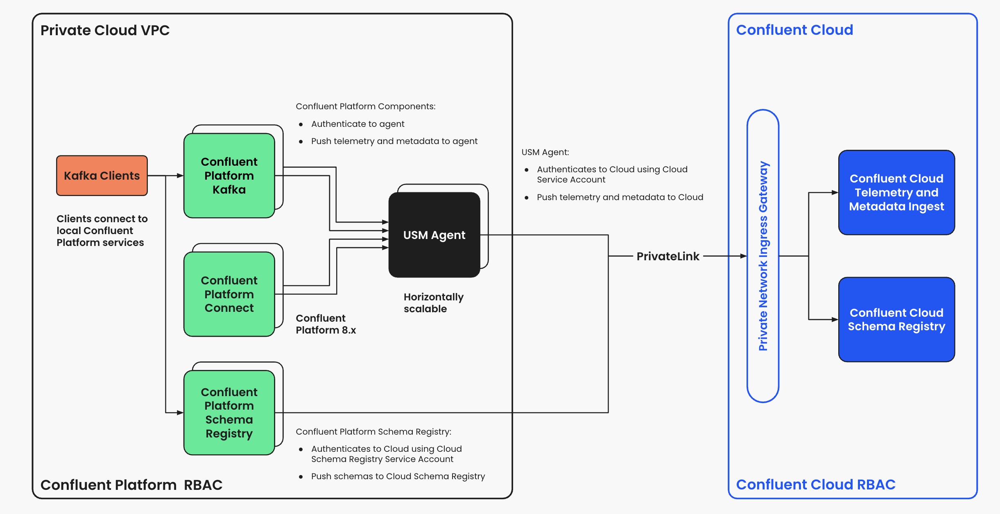
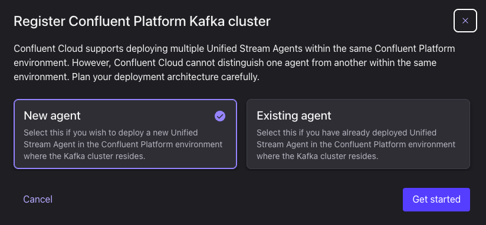
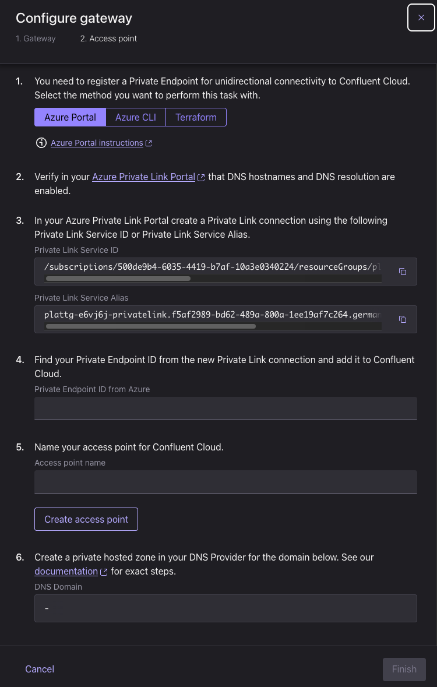
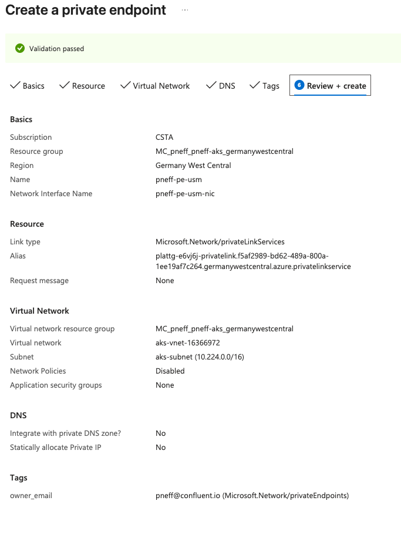
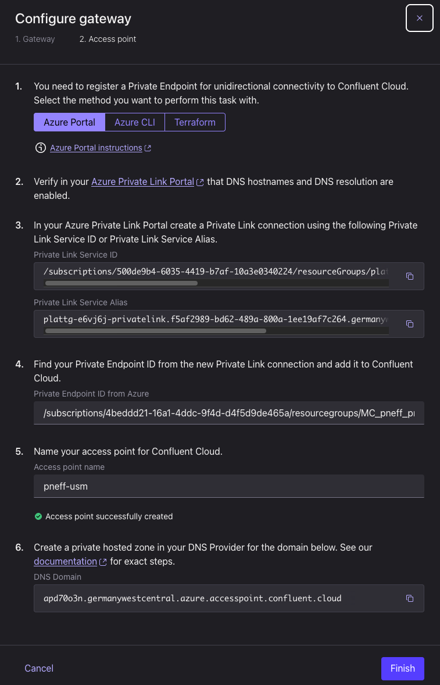
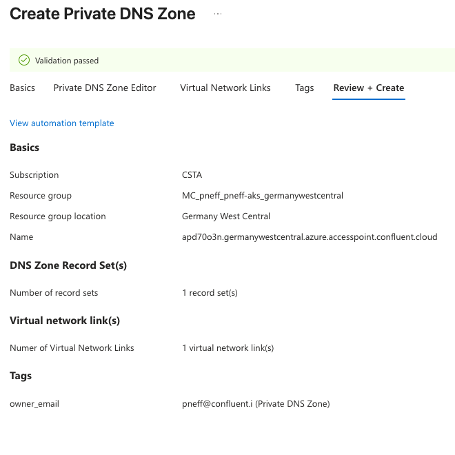
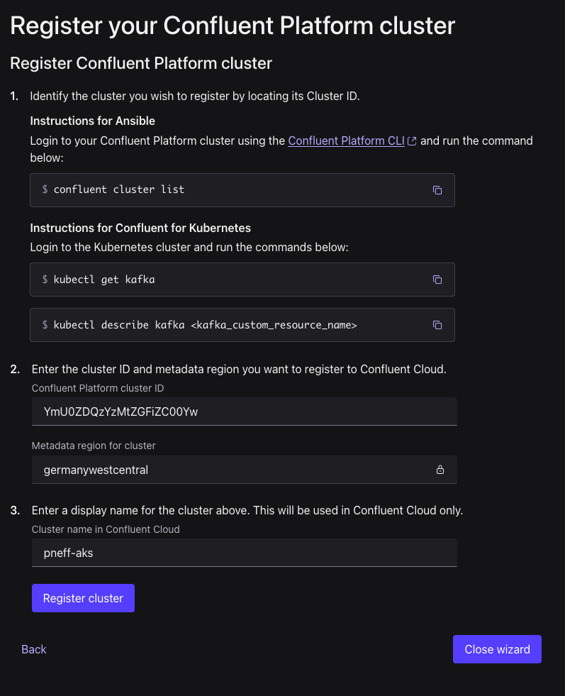
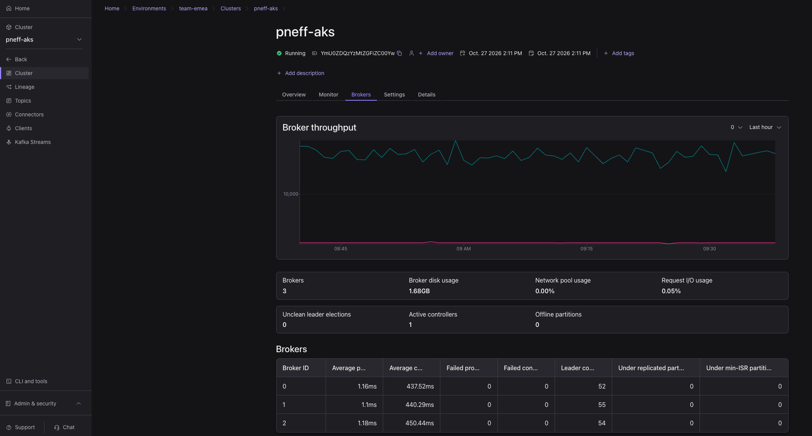
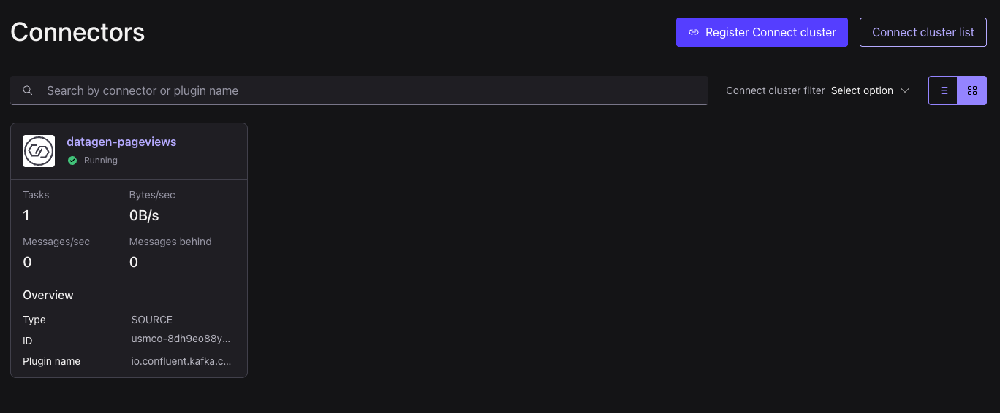

# Confluent Platform on AKS → Confluent Cloud with Unified Stream Manager (USM)

A step-by-step demo in two phases:

- **Phase A:** run a self-managed Confluent Platform (CP) cluster on Azure Kubernetes Service (AKS), using Confluent for Kubernetes (CFK).
- **Phase B:** connect that cluster to Confluent Cloud with **Unified Stream Manager**, over **Azure Private Link**.

**How the steps work**
- Azure and Confluent Cloud steps use the **Portal / CC UI**. The CLI version is in a collapsed *CLI alternative* note.
- Kubernetes steps use `kubectl` and `helm`. Run them from this folder (`cp-on-aks/`); the manifest paths are relative to it.

---

## Table of contents

- [References](#references)
- [Architecture](#architecture)
- [Prerequisites](#prerequisites)
- **Phase A: Confluent Platform on AKS**
  - [A1. Create the AKS cluster and namespace](#a1-create-the-aks-cluster-and-namespace)
  - [A2. Install Confluent for Kubernetes](#a2-install-confluent-for-kubernetes)
  - [A3. Deploy Confluent Platform](#a3-deploy-confluent-platform)
  - [A4. Demo data with Datagen](#a4-demo-data-with-datagen)
- **Phase B: Connect to Confluent Cloud with USM**
  - [B1. USM setup wizard and Private Link](#b1-usm-setup-wizard-and-private-link)
  - [B2. Kubernetes secret](#b2-kubernetes-secret)
  - [B3. Deploy the USM Agent](#b3-deploy-the-usm-agent)
  - [B4. Register the Kafka cluster](#b4-register-the-kafka-cluster)
  - [B5. Connect Kafka to the USM Agent](#b5-connect-kafka-to-the-usm-agent)
  - [B6. Optional: add the Connect cluster](#b6-optional-add-the-connect-cluster)
- [Cleanup](#cleanup)

---

## References

1. [USM in Confluent Cloud](https://docs.confluent.io/cloud/current/usm/overview.html): registration, Azure private networking, agent setup, monitoring, troubleshooting.
2. [USM in Confluent Platform](https://docs.confluent.io/usm/current/overview.html): supported versions, the metrics and metadata that are sent, agent sizing.
3. [Confluent for Kubernetes](https://docs.confluent.io/operator/current/overview.html): deploying CFK, configuring USM, the compatibility matrix.
4. [CFK USM examples](https://github.com/confluentinc/confluent-kubernetes-examples/tree/master/hybrid/usmagent): the manifests this demo is based on, including authentication variants.
5. [Azure Kubernetes Service](https://learn.microsoft.com/azure/aks/): creating a cluster, networking, connecting with `kubectl`.

---

## Architecture



- **Confluent Cloud is the control plane** (monitoring, catalog). Your CP cluster stays the **data plane**, so **message payloads never leave it**. Only metadata, configs and metrics are sent.
- The **USM Agent** (Envoy-based) is the **single outbound path** from CP to Confluent Cloud. KRaft controllers send metadata events, brokers send metrics, Connect sends connector metadata. Confluent Cloud can't send commands back into your cluster.
- **Private networking is mandatory.** On Azure: an **Ingress PrivateLink Gateway** and an **Access Point** in Confluent Cloud, a **Private Endpoint** in the AKS VNet, and a **Private DNS zone**.

---

## Prerequisites

| Component | Version | Note |
|---|---|---|
| Confluent Platform | **8.2.4** | USM needs CP 7.9.6+ or 8.1.0+. 8.0.x is unsupported. 8.2.0–8.2.2 miss some Connect metrics. |
| USM Agent | **1.2.1** | If it misbehaves under CFK, try `cp-usm-agent:1.1.1` in [`20-usmagent.yaml`](k8s/usm/20-usmagent.yaml). |
| CFK | **3.3.1** (Helm chart `0.1718.99`) | |
| Datagen connector | 0.7.2 | |

**Accounts**
- **Confluent Cloud:** `OrgAdmin`, plus an environment with the **Advanced** Stream Governance package.
- **Azure:** a subscription where you can create AKS, private endpoints and private DNS zones (Contributor is enough).

---

# Phase A: Confluent Platform on AKS

Goal: a working, standalone CP cluster with traffic and **no USM yet**.

## A1. Create the AKS cluster and namespace

1. Azure Portal → **Kubernetes services** → **Create** → **Kubernetes cluster**.
2. **Basics:** resource group `rg-usm-lab`, cluster name `aks-usm-lab`, region **Germany West Central**. Keep the defaults for everything else.
3. **Review + create** → **Create**. This takes about 5–10 minutes.
4. Connect `kubectl`: on the cluster page, click **Connect** and run the `az aks get-credentials` command it shows.
5. Create the namespace `confluent`. All CP and USM resources in this demo go there.
   ```bash
   kubectl create namespace confluent
   ```

✅ **Check:** `kubectl get nodes` shows all nodes `Ready`, and `kubectl get namespace confluent` shows `Active`.

<details><summary>CLI alternative</summary>

```bash
az group create --name rg-usm-lab --location germanywestcentral
az aks create -g rg-usm-lab -n aks-usm-lab --location germanywestcentral --generate-ssh-keys
az aks get-credentials -g rg-usm-lab -n aks-usm-lab
kubectl create namespace confluent
```
</details>

## A2. Install Confluent for Kubernetes

```bash
helm repo add confluentinc https://packages.confluent.io/helm
helm repo update
helm upgrade --install confluent-operator confluentinc/confluent-for-kubernetes \
  --version 0.1718.99 --namespace confluent
```

✅ **Check:** `kubectl -n confluent get pods` shows `confluent-operator-…` as `Running`.

## A3. Deploy Confluent Platform

| File | Resource |
|---|---|
| [`10-kraftcontroller.yaml`](k8s/cp/10-kraftcontroller.yaml) | 1 KRaft controller |
| [`11-kafka.yaml`](k8s/cp/11-kafka.yaml) | 3 brokers |
| [`12-schemaregistry.yaml`](k8s/cp/12-schemaregistry.yaml) | 1 Schema Registry (used by Datagen's Avro converter) |
| [`13-connect.yaml`](k8s/cp/13-connect.yaml) | 1 Connect worker with the Datagen plugin |

```bash
kubectl apply -f k8s/cp/10-kraftcontroller.yaml
kubectl apply -f k8s/cp/11-kafka.yaml
kubectl apply -f k8s/cp/12-schemaregistry.yaml
kubectl apply -f k8s/cp/13-connect.yaml

kubectl -n confluent get pods -w      # wait until everything is Running/Ready (several minutes)
```

✅ **Check:** `kubectl -n confluent get pods` shows all `PHASE=RUNNING`.

> ⚠️ If a pod stays `Pending`, run `kubectl describe pod <name>`. The cause is usually storage or capacity.

## A4. Demo data with Datagen

[`14-datagen-connector.yaml`](k8s/cp/14-datagen-connector.yaml) creates the topic `pageviews` and a Datagen connector that produces Avro records.

Datagen produces **continuously**, about 2–5 records per second (a random pause of up to `max.interval: 500` ms between records), until you delete the connector. This steady traffic is what USM shows as throughput in Phase B. The `--max-messages 3` in the check below only limits how many records the consumer reads.

```bash
kubectl apply -f k8s/cp/14-datagen-connector.yaml
```

✅ **Check:**
```bash
kubectl -n confluent get kafkatopic,connector     # connector STATUS=CREATED, TASKS-READY 1/1
kubectl -n confluent exec schemaregistry-0 -c schemaregistry -- env LOG_DIR=/tmp kafka-avro-console-consumer \
  --bootstrap-server kafka.confluent.svc.cluster.local:9071 --topic pageviews \
  --from-beginning --max-messages 3 --formatter-property schema.registry.url=http://localhost:8081
```

> [!NOTE]
> ### Checkpoint A: Confluent Platform runs on AKS
> - ✅ KRaft controller, 3 brokers, Schema Registry and Connect are running in namespace `confluent`
> - ✅ Datagen writes Avro records to `pageviews`, with the schema in the local Schema Registry
>
> **Next:** connect this cluster to Confluent Cloud with USM.

---

# Phase B: Connect to Confluent Cloud with USM

## B1. USM setup wizard and Private Link

The wizard sets up private networking, creates the agent's service account and API key, and generates the **agent configuration file**. You switch to the Azure Portal twice: once for the Private Endpoint, once for DNS.

> [!NOTE]
> ### How the private connection works
> USM only works over a private connection, so the agent never reaches Confluent Cloud over the public internet. You build it from four pieces:
>
> | Piece | Where | What it does | Step |
> |---|---|---|---|
> | **Private Link** (gateway) | Confluent Cloud | Confluent's private entrance in Germany West Central | 2 |
> | **Private Endpoint** | Azure, in `aks-subnet` | A private IP in your VNet (e.g. `10.224.0.6`) that leads to that entrance | 3 |
> | **Access point** | Confluent Cloud | Confluent accepts your endpoint: "this one is allowed in" | 4 |
> | **Private DNS zone** | Azure, linked to the AKS VNet | Makes Confluent's hostname point to the private IP | 5 |
>
> **What happens when the agent connects:**
> 1. The agent looks up its Confluent address (`FRONTDOOR_URL`), e.g. `api-apd70o3n.germanywestcentral.azure.accesspoint.glb.confluent.cloud`.
> 2. Confluent's public DNS answers: "that's an alias for `api.apd70o3n.germanywestcentral.azure.accesspoint.confluent.cloud`".
> 3. That name ends with your Private DNS zone's name, so Azure answers from your zone: **`10.224.0.6`**.
> 4. The agent connects to `10.224.0.6`. The Private Endpoint carries the traffic over Azure Private Link to Confluent Cloud.
>
> If one piece is missing, point 3 returns a public address or none at all, and the agent fails with `503`.

**1. Start the wizard**
CC UI → **Environments** → your environment → **Clusters** → **Register platform cluster**.

 

**2. Network: create the gateway**
**Add network configuration** → **Microsoft Azure**, region **germanywestcentral** → submit. Copy the **Private Link Service alias/ID** it shows.

 

**3. Azure Portal: create the Private Endpoint**
**Private endpoints** → **Create**:
- **Basics:** resource group `rg-usm-lab`, name `pe-confluent-usm`, region **Germany West Central**.
- **Resource:** **Connect to an Azure resource by resource ID or alias** → paste the alias.
- **Virtual network:** the AKS-managed VNet `aks-vnet-…` (in resource group `MC_rg-usm-lab_aks-usm-lab_germanywestcentral`), subnet `aks-subnet`.
- **DNS:** skip; you create the zone in step 5.



After creation, open the endpoint → **Overview** → **JSON View** and copy the **Resource ID**. It looks like `/subscriptions/…/resourceGroups/rg-usm-lab/providers/Microsoft.Network/privateEndpoints/pe-confluent-usm`.

> ⚠️ Putting the endpoint in the AKS-managed VNet is a demo shortcut. In production, bring your own VNet.

**4. Wizard: let Confluent accept the endpoint (access point)**

The endpoint you just created is only a **connection request** to Confluent. Its status in Azure is **Pending**. Confluent accepts it once you tell it which endpoint is yours. That registration is called an **access point**.

1. Back in the wizard, paste the endpoint's **Resource ID** and create the access point.
2. Wait until the access point shows **Ready** (a few minutes).
3. Note the **access point ID**. It starts with `ap-` (e.g. `ap-d70o3n`), and you need it for the DNS zone name in step 5. Find it in the CC UI: your Private Link → **Access points** → **ID** column.
4. In Azure, the endpoint → **Overview** → connection status now shows **Approved**.

> ℹ️ **Two different IDs.** The **Resource ID** comes from Azure (`/subscriptions/…/privateEndpoints/<name>`). You paste it into the wizard. The **access point ID** comes from Confluent Cloud (`ap-…`). It goes into the DNS zone name in step 5, **without the hyphen**.

 

**5. Azure Portal: Private DNS zone**

This is point 3 in the box above: the zone tells AKS "Confluent's hostnames are at your endpoint's private IP". A DNS record needs an IP address, so first get the IP:

- The endpoint → **Settings** → **DNS configuration** → copy the **IP address** (e.g. `10.224.0.x`).

Then **Private DNS zones** → **Create** and go through the tabs:

| Tab | Setting |
|---|---|
| **Basics** | Resource group `rg-usm-lab`. Name `<ap-id-without-hyphen>.germanywestcentral.azure.accesspoint.confluent.cloud`. Use the access point ID from step 4 **without the hyphen**: `ap-d70o3n` becomes `apd70o3n.germanywestcentral.azure.accesspoint.confluent.cloud`. Hostnames use this form, so a zone named `ap-d70o3n.…` is never used. |
| **Private DNS zone editor** | Replace the placeholder with one zone-file line, using your endpoint IP: `* 60 IN A 10.224.0.x`. Alternative: leave it empty and add the record later under zone → **Recordsets** → **Add**. |
| **Virtual network links** | Add a link to the AKS-managed VNet `aks-vnet-…`, with auto-registration **off**. |

**Review + create** → **Create**.



> ℹ️ **What the three settings mean**
> - **Zone name:** must match exactly. Only names ending in the zone name are answered from your zone. Compare it with the alias from point 2 in the box above: `api.`**`apd70o3n.germanywestcentral.azure.accesspoint.confluent.cloud`**.
> - **Record `* 60 IN A <ip>`:** every name in the zone (`*`) points to your endpoint IP (`A` = IPv4 address). `60` means the answer is cached for 60 seconds.
> - **VNet link:** decides who can see the zone. Without it, AKS pods never get the private answer.

**6. Service account**
Create a new service account, e.g. `sa-usm-agent-lab`. The wizard creates its API keys and assigns two role bindings on **your environment**:

| Role | Why |
|---|---|
| **USMAgent** | The agent may send metadata events and metrics to USM |
| **DataSteward** | Required for registration (schemas / governance) |


<details><summary>CLI alternative</summary>

```bash
confluent iam service-account list                       # find the sa-… ID
# Check: --environment is required, without it only organization-level bindings are listed ("None found")
confluent iam rbac role-binding list --principal User:<sa-id> --environment <env-id>
# Add a missing role:
confluent iam rbac role-binding create --principal User:<sa-id> --role UsmAgent    --environment <env-id>
confluent iam rbac role-binding create --principal User:<sa-id> --role DataSteward --environment <env-id>
```
</details>


**7. Download the configuration file**
Click **Generate configuration file** and download the JSON. 

```bash
export AGENT_JSON="$HOME/Downloads/usm-agent-config.json"
jq '{ENVIRONMENT_ID, FRONTDOOR_URL}' "$AGENT_JSON"     # you need these two values in B3
```

> ⚠️ The JSON contains secrets. Don't commit it, and delete it after the demo.

✅ **Check:** DNS resolves to the Private Endpoint IP **from inside AKS**:
```bash
kubectl -n confluent run dnstest --rm -it --restart=Never --image=busybox:1.36 -- \
  nslookup "$(jq -r .FRONTDOOR_URL "$AGENT_JSON" | sed -E 's#https://([^:/]+).*#\1#')"
```

<details><summary>CLI alternative (network)</summary>

```bash
export CC_ENV_ID="env-xxxxxx"
export NODE_RG=$(az aks show -g rg-usm-lab -n aks-usm-lab --query nodeResourceGroup -o tsv)
export AKS_VNET=$(az network vnet list -g "$NODE_RG" --query '[0].name' -o tsv)
export AKS_VNET_ID=$(az network vnet show -g "$NODE_RG" -n "$AKS_VNET" --query id -o tsv)
export AKS_SUBNET_ID=$(az network vnet subnet show -g "$NODE_RG" --vnet-name "$AKS_VNET" -n aks-subnet --query id -o tsv)

# 1. Gateway
confluent network gateway create usm-gw-germanywestcentral \
  --cloud azure --region germanywestcentral --type ingress-privatelink --environment "$CC_ENV_ID"
export CC_GATEWAY_ID="gw-xxxxxx"
confluent network gateway describe "$CC_GATEWAY_ID" --environment "$CC_ENV_ID"
export PLS_ALIAS="<Private Link Service alias from the output>"

# 2. Private Endpoint (--manual-request true is required)
az network private-endpoint create -g rg-usm-lab -n pe-confluent-usm --location germanywestcentral \
  --subnet "$AKS_SUBNET_ID" --connection-name pe-confluent-usm-conn \
  --private-connection-resource-id "$PLS_ALIAS" --manual-request true
export PE_ID=$(az network private-endpoint show -g rg-usm-lab -n pe-confluent-usm --query id -o tsv)
export PE_NIC_ID=$(az network private-endpoint show -g rg-usm-lab -n pe-confluent-usm --query 'networkInterfaces[0].id' -o tsv)
export PE_IP=$(az network nic show --ids "$PE_NIC_ID" --query 'ipConfigurations[0].privateIPAddress' -o tsv)

# 3. Access point (older docs call the flag --private-endpoint-resource-id; check --help)
confluent network access-point private-link ingress-endpoint create usm-ap \
  --cloud azure --gateway "$CC_GATEWAY_ID" --endpoint-resource-id "$PE_ID" --environment "$CC_ENV_ID"
export CC_AP_ID="ap-xxxxxx"

# 4. Private DNS
export PDNS_ZONE="${CC_AP_ID//-/}.germanywestcentral.azure.accesspoint.confluent.cloud"
az network private-dns zone create -g rg-usm-lab -n "$PDNS_ZONE"
az network private-dns record-set a add-record -g rg-usm-lab -z "$PDNS_ZONE" -n '*' -a "$PE_IP"
az network private-dns link vnet create -g rg-usm-lab -z "$PDNS_ZONE" -n aks-vnet-link \
  --virtual-network "$AKS_VNET_ID" --registration-enabled false
```
</details>

## B2. Kubernetes secret

The agent reads its Confluent Cloud API key from a Secret with key `basic.txt`.

```bash
kubectl -n confluent create secret generic usm-ccloud-cred \
  --from-file=basic.txt=<(printf 'username=%s\npassword=%s\n' \
     "$(jq -r .SERVICE_ACCOUNT_API_KEY "$AGENT_JSON")" "$(jq -r .SERVICE_ACCOUNT_API_SECRET "$AGENT_JSON")")
```

✅ **Check:** `kubectl -n confluent get secret usm-ccloud-cred` exists.

## B3. Deploy the USM Agent

[`20-usmagent.yaml`](k8s/usm/20-usmagent.yaml) deploys one agent pod. CP reaches it in-cluster at `usm-agent.confluent.svc.cluster.local:10000`.

1. Open `k8s/usm/20-usmagent.yaml` and replace the two placeholders with the values from the config file (B1 step 7):
   ```yaml
   confluentCloudClient:
     endpoint: <FRONTDOOR_URL>         # e.g. https://api-apd70o3n.germanywestcentral.azure.accesspoint.glb.confluent.cloud:443
     environmentId: <ENVIRONMENT_ID>   # e.g. env-xxxxxx
   ```
2. Deploy the agent:
   ```bash
   kubectl apply -f k8s/usm/20-usmagent.yaml
   kubectl -n confluent get pods -l app=usm-agent      # wait for Running
   ```

✅ **Check:** the agent pod shows `Running`.

## B4. Register the Kafka cluster

Registering tells Confluent Cloud which CP cluster belongs to your environment. Get the Kafka cluster ID:
```bash
kubectl -n confluent get kafka kafka -o jsonpath='{.status.clusterID}'; echo
```

In the wizard, enter the **Kafka cluster ID** and a name (e.g. `pneff-aks`) → **Register cluster**.



<details><summary>CLI alternative</summary>

```bash
confluent usm kafka register "$(kubectl -n confluent get kafka kafka -o jsonpath='{.status.clusterID}')" \
  --name pneff-aks --cloud azure --region germanywestcentral --environment <env-id>
```
</details>

✅ **Check:** CC UI → environment → **Clusters** → **Confluent Platform** tab shows `pneff-aks` with **Metrics delayed**. That's expected: CP doesn't send anything to the agent yet. The next step fixes that.

## B5. Connect Kafka to the USM Agent

The KRaft controller and the brokers get a `usmAgentClient` dependency, and CFK does a rolling restart. The controller sends metadata (topics, configs), and the brokers send metrics. The brokers also disable the legacy metrics reporter. Compare with `diff k8s/cp/11-kafka.yaml k8s/usm/22-kafka-usm.yaml`.

```diff
   dependencies:
+    usmAgentClient:
+      url: http://usm-agent.confluent.svc.cluster.local:10000
```

Apply in order and wait for each roll to finish:

```bash
kubectl apply -f k8s/usm/21-kraftcontroller-usm.yaml   # metadata events
kubectl -n confluent get pods -w
kubectl apply -f k8s/usm/22-kafka-usm.yaml             # metrics
kubectl -n confluent get pods -w
```

✅ **Check:** after a few minutes, **Metrics delayed** disappears. Cluster `pneff-aks` shows the topic `pageviews` and its throughput.



> [!NOTE]
> ### Checkpoint B: CP is monitored in Confluent Cloud
> - ✅ The USM Agent connects to Confluent Cloud over Azure Private Link
> - ✅ Cluster `pneff-aks` and the topic `pageviews` with live throughput are visible in the CC UI
> - ✅ Message payloads never leave your AKS cluster

## B6. Optional: add the Connect cluster

Connect sends connector metadata and metrics through the same agent.

1. Point Connect at the agent (rolling restart):
   ```bash
   kubectl apply -f k8s/usm/23-connect-usm.yaml
   kubectl -n confluent get pods -w
   ```
2. Get the Connect group ID:
   ```bash
   kubectl -n confluent get connect connect -o jsonpath='{.status.groupID}'; echo
   ```
3. In the CC UI, register the Connect cluster with this **group ID** and attach it to `pneff-aks`.

<details><summary>CLI alternative</summary>

```bash
confluent usm connect register "$(kubectl -n confluent get connect connect -o jsonpath='{.status.groupID}')" \
  --confluent-platform-kafka-cluster "$(kubectl -n confluent get kafka kafka -o jsonpath='{.status.clusterID}')" \
  --cloud azure --region germanywestcentral --environment <env-id>
```
</details>

✅ **Check:** the connector `datagen-pageviews` shows up in the CC UI.
 <!-- TODO screenshot -->

---

## Cleanup

1. CC UI: deregister the Connect cluster (if you did B6) and then the Kafka cluster (environment → **Clusters** → **Confluent Platform**).
2. CC UI: delete the access point and then the gateway (environment → **Network management**).
3. Azure Portal: delete resource group `rg-usm-lab`. This removes AKS (and its `MC_` group), the Private Endpoint and the DNS zone. If the `MC_` group won't delete, delete the Private Endpoint first.
4. CC UI: delete the service account `sa-usm-agent-lab` and its API key. Delete the downloaded JSON.

<details><summary>CLI alternative</summary>

```bash
confluent usm connect deregister <usmcc-id> --environment "$CC_ENV_ID"   # only if you did B6
confluent usm kafka deregister <usmkc-id> --environment "$CC_ENV_ID"
confluent network access-point private-link ingress-endpoint delete <ap-id> --environment "$CC_ENV_ID"
confluent network gateway delete <gw-id> --environment "$CC_ENV_ID"
az group delete --name rg-usm-lab --yes --no-wait
```
</details>
